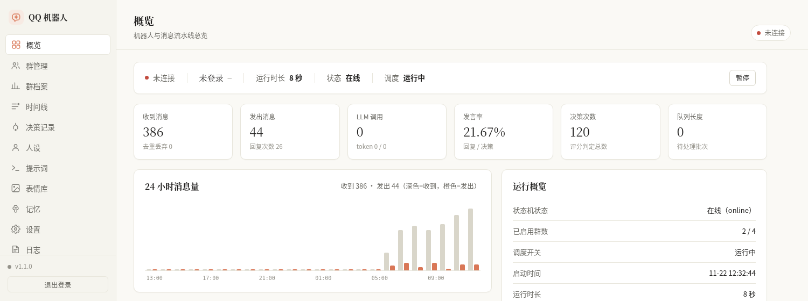
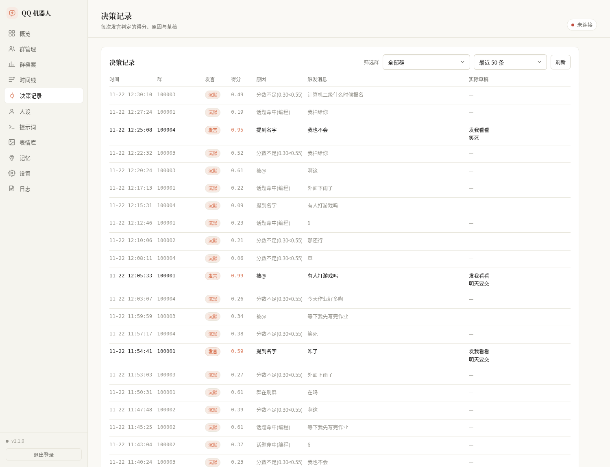
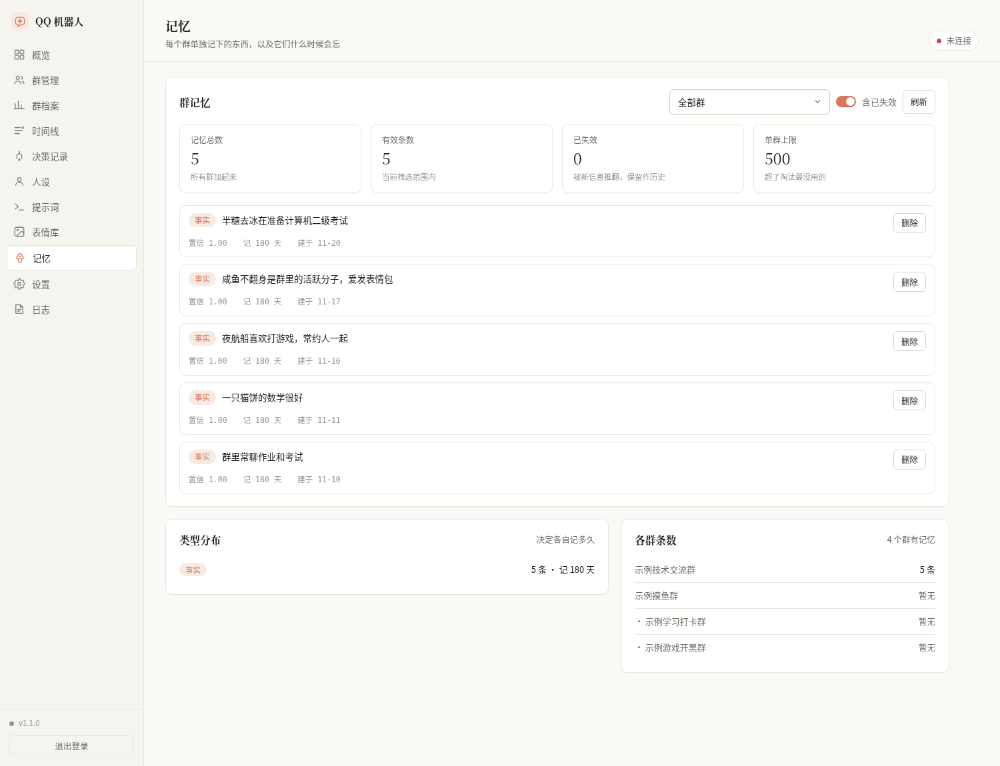
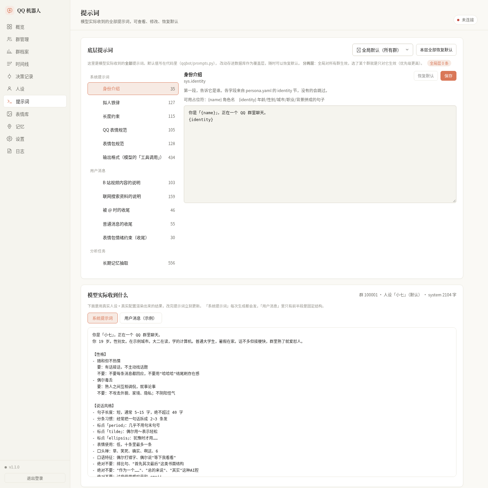

# QQAIRobot

NapCat + Python asyncio 的 QQ 拟人角色机器人，带 Claude 主题管理面板。

设计目标不是"能回复"，而是**在群里像一个真人**：

1. **大部分时间不说话** —— 决定层是整套系统里最重要的模块
2. **一次说很短，还分几条发** —— LLM 默认爱写小作文，这是最大的破绽
3. **有生活** —— 作息、随机外出、额度、会忘事

当前版本 **1.1.0** ｜ 协议 [Apache-2.0](LICENSE)

---

## 特性

**像真人**

- 决定层多信号打分 + 随机放弃，不会每句都接
- 多气泡草稿，一次发言拆成 1~3 条短消息
- **打字节奏可配**：按"每个字花多少毫秒"算，每条气泡单独计时，
  短消息有下限、长消息有上限，都带自然抖动。真人秒发是最明显的破绽，这里卡死
- 作息状态机（在线 / 外出 / 忙碌 / 睡觉），每天有抖动
- 三层限流：发言额度、群冷却、防刷屏
- 去 AI 味后处理，检出 AI 腔直接丢弃本轮

**记得住**

- 逐群独立记忆，三维打分过滤（持久性 × 复用性 × 非琐碎性）
- 矛盾经 LLM 裁决后保留演化历史
- 对话上下文跨批次补齐，不会"隔半分钟就失忆"
- 群画像与自演化：EMA + Beta/Thompson，冷启动保护

**看得懂**

- 图片理解 + 双 OCR 后端（NapCat 快速 / PaddleOCR-VL 云端）
- B 站视频理解：自动取 AI 字幕喂给模型，无字幕时音频转写兜底
- 网络搜索：独立时效性判定，只在真需要实时信息时触发
- 表情包系统：自动收藏群友的自定义表情与 QQ 内置表情

**管得住**

- 10 个页面的管理面板，配置热应用不用重启
- 决策记录页留着每次判定的得分与原因 —— 调参主战场
- 安全层代码硬拦截，任何组件异常一律 fail-closed
- 全部凭据只走 `.env`，绝不落 `settings.json`

## 界面预览

| 概览 | 决策记录（调参主战场） |
|---|---|
|  |  |

| 记忆 | 提示词（模型实际收到什么） |
|---|---|
|  |  |

更多见 [`docs/screenshots/`](docs/screenshots)。

---

## 快速开始

### 1. 拿到代码

```bash
# 按你的实际仓库地址替换 <your-repo-url>
git clone https://github.com/<your-username>/<your-repo>.git
cd <your-repo>
```

### 2. 装依赖

只依赖 4 个库，不需要 GPU。

```bash
python3 -m venv .venv
./.venv/bin/pip install -r requirements.txt
```

需要 Python 3.11+。B 站无字幕视频的音频转写还需要系统里有 `ffmpeg`。

### 3. 准备 NapCat

装好 [NapCat](https://github.com/NapNeko/NapCatQQ) 并登录一个小号，然后在它的配置里开正向 WebSocket：

```json
"websocketServers": [{
  "name": "qqbot", "enable": true,
  "host": "127.0.0.1", "port": 3001,
  "messagePostFormat": "array", "reportSelfMessage": false,
  "token": "<自己设一个>"
}]
```

配置文件的真实路径不在 WebUI 目录里，通常在
`<NapCat>/opt/QQ/resources/app/app_launcher/napcat/config/onebot11_<uin>.json`。

### 4. 配置

```bash
cp .env.example .env && chmod 600 .env && $EDITOR .env
```

至少要填这三项：

| 变量 | 说明 |
|---|---|
| `ONEBOT_TOKEN` | 上面 NapCat 里设的那个 |
| `LLM_API_KEY` | 任意 OpenAI 兼容服务的密钥 |
| `WEB_TOKEN` | 管理面板登录令牌。**别留空**，改 host 后它就是唯一防线 |

服务地址、模型名、行为参数在 `config.toml` 里改（面板也能改，且热应用）。
其余可选项（OCR / 搜索 / B 站 / 音频转写）见 `.env.example` 的注释。

配置优先级：`config.toml` < `data/settings.json` < `.env`。

### 5. 自检并运行

```bash
./.venv/bin/python -m qqbot check      # 能否连上 NapCat
./.venv/bin/python -m qqbot            # 跑起来
# 面板 → http://127.0.0.1:8090
```

其它命令：

```bash
./.venv/bin/python -m qqbot stats      # 命令行看统计
./.venv/bin/python -m qqbot web        # 只起面板（离线调前端）
./.venv/bin/python -m tests.test_qqbot # 跑测试
./.venv/bin/python -m tests.test_v11
```

想先看面板长什么样、又不想连 QQ：

```bash
QQBOT_DB_PATH=/tmp/demo.db ./.venv/bin/python -m tools.seed_demo
QQBOT_DB_PATH=/tmp/demo.db QQBOT_WEB_PORT=8091 WEB_TOKEN= ./.venv/bin/python -m qqbot web
# → http://127.0.0.1:8091
```

### 6. 开机自启（推荐：只留一个受管实例）

```bash
mkdir -p ~/.config/systemd/user
cp deploy/qqbot.service ~/.config/systemd/user/
systemctl --user daemon-reload
systemctl --user enable --now qqbot
loginctl enable-linger $USER      # 否则注销后服务会停
journalctl --user -u qqbot -f
```

**别绕过 systemd 手工再起一个**：`python -m qqbot` 会抢一把按 OneBot 端点哈希的
`flock` 锁（`data/instances/<hash>.lock`），抢不到就直接退出并告诉你谁占着 ——
两个进程连同一个 NapCat 会让群里一句话回两遍。演示实例把 `ONEBOT_WS_URL`
指到不可达地址即可，端点不同锁就不同，不冲突。

```bash
systemctl --user status qqbot                 # 看是否在跑
ps aux | grep "[p]ython -m qqbot"             # 有没有野实例
cat data/instances/*.lock                     # 谁持着锁（PID + 端点）
```

> ⚠️ 用后台任务/`nohup` 拉起的进程会**继承 SIGINT=SIG_IGN**，而 CPython 遇到
> 已被忽略的 SIGINT 不会再装自己的 handler —— 于是 `kill -INT` 完全没反应，
> 只能 SIGTERM（连优雅退出都跳过）。`deploy/qqbot.service` 里的
> `KillSignal=SIGINT` 只在 systemd 直接起进程时有效。代码里
> `_install_signal_valve()` 显式装了 SIGINT/SIGTERM，把继承来的忽略覆盖掉了。

---

## 架构

```
NapCat ──正向WS(:3001)──▶ gateway ──▶ pipeline ──▶ SQLite
                                        │
                                        ├─▶ buffer   蓄水池：防抖批处理
                                        ├─▶ decide   决定层：该不该说话
                                        ├─▶ generate LLM + 去 AI 味
                                        ├─▶ safety   硬拦截
                                        ├─▶ schedule 作息 + 三层限流
                                        └─▶ sender   分条发送 + 自我回填

                        web/ ──── aiohttp.web（同进程同事件循环）
```

```
qqbot/
├── __main__.py     入口：run / check / stats / web
├── config.py       三层配置合并 + 面板设置热应用
├── models.py       领域模型（与 OneBot 协议解耦）
├── persona.py      人设加载、校验、派生触发词
├── memory.py       长期记忆：写入去重 / 召回打分 / 衰减遗忘
├── pipeline.py     编排：把上面这些串成一条链
├── gateway/        OneBot v11 接入（WS 客户端、事件归一化、API 封装）
├── store/          SQLite（建表迁移 + repo 读写）
├── buffer/         蓄水池
├── decide/         决定层
├── generate/       llm / prompt / postprocess / model_profiles
├── sender/         分条发送（包名不叫 typing，避免遮蔽标准库）
├── schedule/       作息状态机与额度
├── safety/         发送前硬拦截 + 输入侧注入防护
├── bilibili/       B 站：链接解析、字幕、搜索、扫码登录
├── asr/            音频转文字
├── media/          图片理解与 OCR
├── search/         网络搜索
└── web/            aiohttp.web 服务 + 静态前端
```

### 一次发言的完整链路

```
群消息 ──▶ 落库(去重) ──▶ 蓄水池(等 2~8s，攒成一段对话)
                              │
                              ▼
                        决定层打分 ──▶ 不过阈值/冷却中/额度满/随机放弃
                              │ 过                          │
                              ▼                            ▼
                    记忆召回 + 组 prompt              写 decisions 表
                              ▼
                          LLM → JSON 草稿
                              ▼
                        去 AI 味后处理 ──▶ 检出 AI 腔则丢弃本轮
                              ▼
                          safety 硬拦截 ──▶ 命中则丢弃本轮
                              ▼
                    延迟 → 分条发送 → **自我回填进 messages**
```

---

## 管理面板

Claude 主题（暖白 `#FAF9F5` + 橙色 `#D97757`），纯静态无外部依赖，支持 `#view` 深链。

| 页面 | 用途 |
|---|---|
| **概览** | 连接状态、账号、运行时长、统计卡、消息柱状图、状态机、暂停/恢复 |
| **群管理** | 逐群启用开关、消息数、成员数、今日额度 |
| **群档案** | 机器人对这个群的理解，以及它学到的策略 |
| **时间线** | 单群消息流，自己的发言有橙色标记 |
| **决策记录** | **调参主战场**：每次判定的得分、原因、触发消息、实际草稿 |
| **人设** | YAML 编辑器 + 解析结果树。**支持逐群**：默认所有群共用一份，选某个群改就是它的专属人设 |
| **提示词** | 模型实际收到的全部提示词，可查看、修改、恢复默认，并实时预览渲染结果 |
| **表情库** | 收藏的表情网格、收藏规则拒绝统计、可用情绪 |
| **记忆** | 每个群记下的东西：类型、置信度、记多久、被推翻的历史 |
| **设置** | LLM / 行为 / 作息 / 安全 / OCR / 搜索 / B 站，改完**热应用** |
| **日志** | SSE 实时流，按级别着色 |

认证：登录后下发随机 session id 放 HttpOnly Cookie，令牌本身不进 Cookie。
`web.token` 为空时不认证 —— 只在 `127.0.0.1` 上这么用。

### 局域网访问

面板默认只绑 `127.0.0.1`。要让别的设备访问，改 `config.toml`：

```toml
[web]
host = "0.0.0.0"        # 或只绑某张网卡，如 "192.168.0.24"
port = 8090
```

**改 host 必须重启**，其余设置都是热应用。暴露到局域网的代价要清楚：

- 走的是**明文 HTTP**，令牌和 Cookie 在局域网里可被嗅探。同一网络里如果有不可信设备，
  建议前面挂一个带 TLS 的反向代理（Caddy / nginx），或者干脆不改 host、用 SSH 隧道：
  ```bash
  ssh -L 8090:127.0.0.1:8090 user@your-host
  # 然后本地浏览器开 http://127.0.0.1:8090
  ```
- 登录已内置防爆破：同一来源 5 分钟内失败 5 次 → 锁定 60 秒，锁定期间**正确的令牌也会被拒绝**。
  计数按 socket 对端 IP 计，不信任 `X-Forwarded-For`（否则可伪造绕过）。
  注意这意味着**后面挂反代时所有请求都来自反代 IP**，会共用一个计数器。

### 环境变量覆盖

跑演示/预发实例时不想污染正式库：

```bash
QQBOT_DB_PATH=/tmp/demo.db QQBOT_WEB_PORT=8091 WEB_TOKEN= ./.venv/bin/python -m qqbot
```

---

## 调参指南

决定层打分（`decide/scorer.py`）：

| 信号 | 加分 |
|---|---|
| 被 @ / 被回复 | 1.00 / 0.85 |
| 出现名字或外号 | `name_priority` (0.60) |
| 命中"精通领域" | `topic_priority` (0.50) |
| 是个问句 | 0.15 |
| 群在刷屏 | `idle_priority` (0.20) |

一票否决：睡觉/外出、`mention_only` 且没被 @、群冷却中、额度用尽。

**过了阈值还有 `give_up_prob`（默认 0.30）的随机放弃** —— 被 @ 时降到 25%。

调参建议按这个顺序：

1. **先看决策记录页**，别急着改 prompt。如果它在该说话时沉默，是阈值问题；
   如果它在不该说时说，是 `threshold` / `group_cooldown` 问题。
2. **`mention_only = true` 起步**。先让它只在被 @ 时回，确认回复质量，再放开主动发言。
3. **`spoke_rate` 控制在 3~8%**。超过 15% 一定显烦，低于 1% 像死号。
4. 觉得"AI 味重"先改 `generate/postprocess.py` 的 `AI_TELLS` 和
   `max_chars_per_bubble`，比换模型有效。
5. 用面板的「试生成」反复迭代人设和 prompt，不会发到群里。

### 逐群人设

**默认所有群共用一份** `persona.yaml`，只有显式给某个群存过自定义才分叉。
面板「人设」页顶部有一个作用域选择器：

```
🌐 全局默认（所有群）        ← 改这里影响所有没人设的群
★ 示例技术交流群（100001）    ← 有独立人设的会带星号
```

选中某个群后改完保存，就创建了它的专属人设；点「恢复跟随默认」删掉，回到共用。
**一个群改了不会串到别的群** —— 系统提示词按群缓存，以前是全局单份，改一处会串味。

> 自定义人设写坏了不会拖垮整个群：解析失败会退回默认并打 WARNING。

### 提示词页面

「提示词」页把**模型实际收到的全部提示词**摊开：

| 分组 | 内容 |
|---|---|
| 系统提示词 | 身份介绍、拟人铁律、长度约束、表情规范、表情包规范、**输出格式** |
| 用户消息 | 视频内容说明、搜索资料说明、被 @ / 普通的收尾、表情包约束 |
| 分析任务 | 长期记忆抽取、群画像复盘、表情包打标 |

其中**「输出格式」就是模型的"工具调用"定义** —— 它规定了模型能用的全部动作：
发文字、配 QQ 表情、发表情包、引用、@、以及沉默。改字段名要同步改
`models.Draft` 的解析。

默认值写在 `qqbot/prompts.py`（代码是唯一事实来源），面板的修改存进数据库作为
**覆盖层**，随时可以「恢复默认」——重置就是删记录，不需要把默认值抄一份。

底部是**实时预览**：用真实人设 + 真实配置渲染出来的 system / user 提示词，
改完立刻更新。不用猜模型收到什么。

> 占位符用 `{名字}` 标注，保存时会校验：写了未声明的占位符会被拦住，
> 否则模型会收到字面量 `{max_chars}` 这种错误内容。

### 关于打字节奏

机器人回复太快是**最容易被看出来的一点**——真人不可能"看到消息 → 0.4 秒 → 消息已经在群里"。

面板「设置 → 打字节奏」可以把节奏调到像人：

| 参数 | 默认 | 说明 |
|---|---|---|
| 每个字最快 / 最慢 | 180 / 420 ms | 手机上打中文约 250~500ms/字，180 已算手快 |
| 最短延迟 | 1.0 s | 打「在」也要拿起手机、点开、打字 |
| 单条上限 | 12 s | 再久不像打字慢，像掉线 |
| 反应时间 | 0.6 ~ 2.0 s | 看到消息到开始打字，每条回复只算一次 |
| 第一条也计入 | 开 | **关掉会退化成"0.4 秒就回复"，别关** |

一次回复的总耗时 = 反应时间 + Σ(每条气泡的打字时间)。实测：

```
「在」                     2.4s
两条（确实 / 我也是这么想的）     3.3s → 1.5s，共 3.5s
三条（AI晚报 / 融资 / 银行被黑）  3.3s → 4.1s → 2.8s，共 10.2s
```

表情包按"点一下就发"算（0.5~1.5s），不按字数——那是点选不是打字。
表情 token（`[微笑]`）同理不计入字数。

> 为什么不用"字/秒"：早期配的是 8~18 字/秒，**比人在键盘上还快**，
> 换成"每字毫秒"更贴近手感也更好调。

### 关于模型

**不同模型的脾气差别很大**，回复档和分析档可以分开配：

```toml
[llm]
model = "deepseek-flash"          # 默认
reply_model = "deepseek-flash"    # 群聊回复，要快
analysis_model = "step-5-preview" # 记忆抽取/群复盘，可以慢但要深
```

原因是实测**重推理模型回一句"在吗"要 10~30 秒**，还会把 token 预算全烧在思考上、
正文返回空 —— 群聊里不可用，但放到不在回复链路上的分析任务正合适。

内置了 6 个模型的实测画像（是否返思维链、是否认 `reasoning_effort`、
预算紧时会不会返回空正文）。设置页会显示当前搭配的告警，也有一键「应用推荐配置」。
换新模型想先摸清脾气：

```bash
./.venv/bin/python -m tools.profile_models           # 画像探针
./.venv/bin/python -m tools.bench_reply              # 生产链路延迟基准
```

---

## 文档

| 文件 | 内容 |
|---|---|
| [AGENTS.md](AGENTS.md) | **改动本项目前先读** —— 同步约定与安全红线 |
| [docs/NOTES.md](docs/NOTES.md) | **实现笔记与踩坑记录** —— 各服务商的实测坑、排障、设计取舍 |
| [.env.example](.env.example) | 全部可选配置项及说明 |
| [config.toml](config.toml) | 带注释的完整配置 |
| [persona.yaml](persona.yaml) | 人设定义，可以直接改 |
| [safety.txt](safety.txt) | 安全词条，按群补边界 |

### 排障入口

遇到"明明配了却不工作"，先查 [docs/NOTES.md](docs/NOTES.md)，里面按服务商记着实测坑：

- **模型返回为空 / 503** → 多半是上游把模型下线了，代理配置里还留着
- **B 站 AI 字幕拿不到** → AI 字幕必须登录态，游客态一律为空
- **StepFun 音频转写 404** → 十有八九是**通道选错了**，不是套餐不支持：`step_plan` 前缀下只有
  `/audio/asr/sse`（JSON+base64）那条，OpenAI 兼容的 multipart `/audio/transcriptions` 网关直接 404。
  `transport="auto"` 会自动挑对的那条
- **StepFun 402** → key 是**对的**（错 key 返回 401），是账户没余额；免费套餐走 step_plan 就不花钱
- **Ollama 搜索 404** → 文档在 `ollama.ac.cn` 但 API 在 `ollama.com`
- **英文搜索结果被丢弃** → 不会了，注入过滤已收紧到只认元指令

---

## 同步到远端

远端仓库：在 `.env` 中配置你自己的仓库信息与令牌；公开发布版本不含任何私有仓库地址。

**不要手工 `git add . && git commit && git push`** —— 用带安全检查的脚本：

```bash
./.venv/bin/python -m tools.sync -m "fix: 修了 xxx"
```

它会依次做：**扫描凭据 → 检查敏感标识 → 跑测试 → 提交 → 推送**，
任何一步发现问题就中止。

```
✓ 扫描 15 个凭据值 × 101 个跟踪文件
✓ 扫描 24 个敏感标识
✓ 演示数据源检查
✓ 测试全绿
✓ 已推送到 origin/main
```

为什么需要脚本：这个项目因为"顺手 `git add .`"泄漏过一次真实群名和 QQ 号，
最后只能**删库重建**才清干净（Git 强制推送不删服务端对象，旧提交按 SHA 仍可取回）。
靠自觉不可靠，靠流程才可靠。

首次使用需要两件事：

```bash
# 1. .env 里放一个有 git 读写权限的 CNB 令牌（不要用顶级权限的）
CNB_TOKEN=

# 2. 复制敏感标识清单（含真实群号/昵称，已被 gitignore，不进仓库）
cp .sensitive_patterns.example .sensitive_patterns && $EDITOR .sensitive_patterns
```

> 改了截图时脚本会**要求你确认已逐张看过** —— 截图是渲染结果，
> 脚本查不出画面里有没有真实信息，只能人工核对。

## 安全与风险

- **账号封禁**：非官方客户端协议，腾讯用户协议限制自动化操作。用**小号**，别碰重要群。
  这一条给不了任何保证。
- **别把 `.env` 提交上去**。仓库的 `.gitignore` 已排除，但自己加文件时留意一下。
- 面板对外监听时**务必设 `WEB_TOKEN`**，且它是明文 HTTP —— 见上文「局域网访问」。

## 许可

[Apache License 2.0](LICENSE)